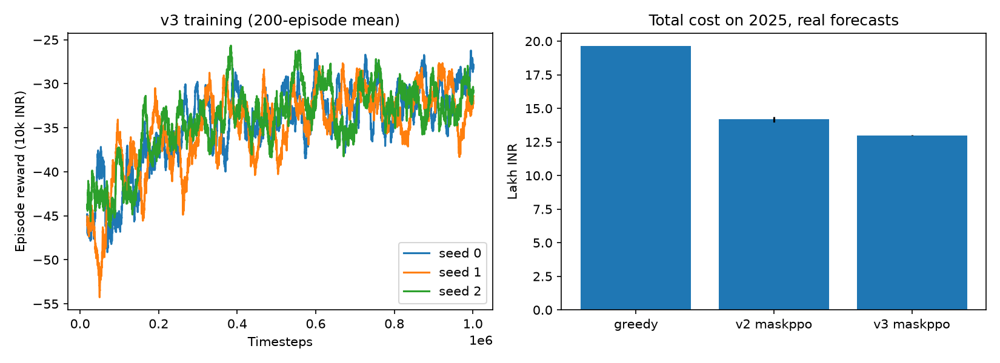
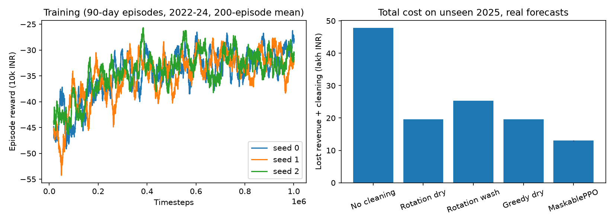

# DustWise

Dust cuts solar output in Rajasthan, but washing panels uses scarce water. DustWise trains an RL agent that decides each day which of 10 panel blocks to clean, and whether to dry-brush or water-wash it. It uses real weather, dust and day-ahead forecast data for Jaisalmer.

The final agent is **v3: MaskablePPO** (`v3/`). On the unseen 2025 test year it costs **13.00 ± 0.04 lakh INR**, which is **34% cheaper** than the best rule-based baseline (19.63).

## RL formulation (final agent, v3)

| | |
|---|---|
| **State** (26) | loose dust loss of each block ×10, cemented dust loss of each block ×10, water tank level, day-ahead forecast of irradiance and rain, today's dust level, season (sin/cos of day of year) |
| **Action** (21) | `0` idle, `1–10` dry-brush block *i*, `11–20` water-wash block *i* (one crew, one block a day). Water washes are masked out when the tank holds less than one wash. |
| **Reward** | `−(revenue lost to soiling + labour + water) / 10,000 INR` per day |
| **Episode** | 90 random consecutive days from the training years |

**Dynamics (one step = one day):**
1. The crew cleans in the morning. A dry brush removes 90% of the loose dust. A water wash removes all the dust but needs 3,640 L from the tank.
2. The panels generate power with their remaining soiling loss, using the weather that actually happened.
3. The day's weather then updates the dust:
   - Rain of 6 mm or more washes every block clean.
   - Lighter rain cements the loose dust, and only water can remove cemented dust.
   - New dust settles in proportion to that day's CAMS dust level.
4. The tank refills by 1,000 L a day, up to 10,000 L.

**Algorithm:** MaskablePPO (sb3-contrib) with an MLP of 128×128, γ = 0.9 and an entropy bonus of 0.01, trained for 1M steps on 2022-08 to 2024. The test year, 2025, is never seen during training.

**Baselines:** no cleaning; daily rotation with a dry brush; daily rotation with a water wash; greedy (brush the dustiest block, but skip the day if heavy rain is forecast). Greedy is the strongest.

## Results (2025, unseen, real forecasts, 3 seeds)

| Policy | Cost (lakh INR) | Energy lost (MWh) | Water (kL) |
|---|---|---|---|
| Greedy dry (baseline) | 19.63 | 735 | 0 |
| v2 DQN | 17.30 ± 0.77 | 632 | 220 |
| v2 MaskablePPO | 14.18 ± 0.19 | 513 | 204 |
| **v3 MaskablePPO** | **13.00 ± 0.04** | **467** | **175** |



## How the project developed

| Version | What changed | 2025 cost (lakh INR) | Details |
|---|---|---|---|
| v1 (repo root) | DQN on the env above, with 24 inputs and perfect forecasts | 18.01 (greedy: 19.41) | [below](#v1-dqn-with-perfect-forecasts) |
| v2 | Real day-ahead forecasts, action masking, five-algorithm comparison, drought study | 14.18 ± 0.19 | [`v2/README.md`](v2/README.md) |
| v3 | Season input and entropy bonus, chosen on a 2024 validation year | 13.00 ± 0.04 | [`v3/README.md`](v3/README.md) |

Each version subclasses the previous environment, so the soiling, rain, cleaning and cost dynamics are the same throughout.

## Run

Python 3.12. Run everything from the repo root. The data is already cached in `data/`, and the trained models are in `models/`, `v2/models/` and `v3/models/`, so the evaluate commands work straight away.

```bash
python -m venv .venv && source .venv/bin/activate
pip install -r requirements.txt

# final agent (v3)
python -m v3.train 0        # seeds 0, 1, 2; about 40 min each on 1 CPU thread
python -m v3.evaluate       # table + v3/results_v3.png

# v2 and v1
python -m v2.forecast       # forecast accuracy (fetches forecasts if not cached)
python -m v2.train maskppo 0
python -m v2.evaluate       # algorithm comparison, drought study + v2/results_v2.png
python data.py              # weather and dust summary (fetches if not cached)
python train.py             # v1 DQN, about 10 min on CPU
python evaluate.py          # v1 table + results.png
```

## Files

| File | Purpose |
|---|---|
| `data.py` | fetch and cache the Open-Meteo weather and dust data |
| `env.py` | `DustWiseEnv`, the base Gymnasium environment |
| `train.py`, `evaluate.py` | v1 DQN training and evaluation |
| `v2/forecast.py` | fetch and cache the real day-ahead forecasts; print their accuracy |
| `v2/env_v2.py` | `DustWiseV2`: forecasts, action masks, water supply |
| `v2/train.py`, `v2/evaluate.py` | five algorithms and the drought study |
| `v3/env_v3.py` | `DustWiseV3`: adds the season input |
| `v3/train.py`, `v3/evaluate.py` | final agent training and evaluation |

## Constants and sources

| Value | Source |
|---|---|
| Soiling 0.4 %/day | Valerino et al., *Solar Energy* 2020 (Gandhinagar, 0.37 %/day), https://doi.org/10.1016/j.solener.2020.03.118 |
| Rain ≥ 6 mm cleans the panels; soiling capped at 30% | pvlib Kimber model, https://pvlib-python.readthedocs.io/en/v0.9.3/reference/generated/pvlib.soiling.kimber.html |
| Light rain cements dust; dry brushing leaves cemented particles | Valerino 2020; https://doi.org/10.1016/J.RENENE.2025.124815 |
| Water 2 L per module, ₹240/kL; labour ₹0.20 per module | https://www.pv-magazine-india.com/2018/10/02/study-high-risk-through-water-use-in-solar-sector/ , BHEL tender https://tenders.bhel.com/sites/default/files/Corrected%20Pages.pdf |
| Tariff ₹2.5/kWh, PR 0.78 | https://pv-magazine-india.com/2024/02/09/sjvn-allocates-1-5-gw-of-solar-at-0-030-kwh |

## Data

Daily shortwave radiation and precipitation come from the [Open-Meteo Historical Weather API](https://open-meteo.com/en/docs/historical-weather-api) (ERA5). Hourly dust comes from the [Open-Meteo Air Quality API](https://open-meteo.com/en/docs/air-quality-api) (CAMS) and is averaged to daily values. Day-ahead forecasts come from the [Open-Meteo Previous Runs API](https://open-meteo.com/en/docs/previous-runs-api), archived from 2024-01-20. All are for Jaisalmer (26.91 N, 70.91 E), 2022-08-05 to 2025-12-31, and are cached in `data/`.

Weather data by [Open-Meteo.com](https://open-meteo.com/) (CC BY 4.0). Dust data from the Copernicus Atmosphere Monitoring Service (CAMS).

## v1: DQN with perfect forecasts

v1 is the code in the repo root. A Stable-Baselines3 DQN (128×128, γ = 0.9, 3-step returns, 500k steps) sees 24 inputs: the same as v3 without the season, and with the weather that actually happened instead of a forecast.

| Policy (2025) | Cost (lakh INR) | Energy lost (MWh) | Water (kL) |
|---|---|---|---|
| No cleaning | 47.79 | 1912 | 0 |
| Rotation dry | 19.62 | 732 | 0 |
| Rotation wash | 25.29 | 961 | 371 |
| Greedy dry | 19.41 | 725 | 0 |
| **DQN** | **18.01** | **644** | 335 |

The DQN is 7% cheaper than the best baseline. Across training seeds 0–3 its 2025 cost was 18.0 ± 0.7 lakh INR, and every seed beat greedy. To change the seed, edit `SEED` in `train.py`.



## Limitations

- Before 2024-01-20 there is no forecast archive, so the training years use the observed weather as the forecast. Only 2024 and 2025 have real forecasts.
- The dust input is the CAMS value for the same day, not a forecast, so the agent effectively has a perfect one-day dust forecast. The greedy baseline gets the same information.
- The soiling and cleaning constants come from nearby Indian and desert studies, not measurements from Jaisalmer itself.
