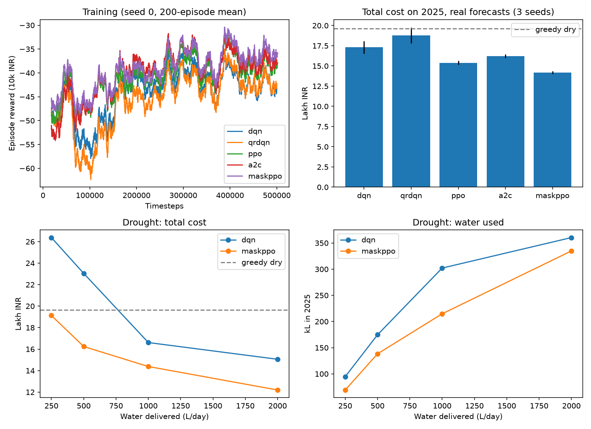

# DustWise v2

v1 (in the repo root) is unchanged. v2 adds four things on top of it.

| v2 change | Where |
|---|---|
| **Real day-ahead forecasts.** The agent sees the forecast issued 24 h earlier ([Open-Meteo Previous Runs API](https://open-meteo.com/en/docs/previous-runs-api), archived from 2024-01-20), not the weather that actually happened. Days before the archive fall back to the observed weather. | `forecast.py`, `env_v2.py` |
| **Action masking.** A water wash is masked out when the tank holds less than one wash (3,640 L). MaskablePPO uses the mask. | `env_v2.py: action_masks()` |
| **Algorithm comparison.** DQN, QR-DQN, PPO, A2C and MaskablePPO are trained on the same env, with γ = 0.9, a 128×128 MLP, 500k steps and seeds 0–2. | `train.py` |
| **Drought study.** Daily water delivery is varied (250–2,000 L/day) to see how the agent trades washing for brushing. | `train.py`, `evaluate.py` |

`DustWiseV2` subclasses the v1 env, so the soiling, rain, cleaning and cost dynamics are identical. With perfect forecasts and 1,000 L/day it reproduces v1 step for step.

## How good are the real forecasts? (2024-25, 712 days)

- **Irradiance:** correlation 0.89 with what actually happened, nRMSE 13%.
- **Heavy rain (≥ 6 mm):** the forecast caught 14 of 25 days and gave 18 false alarms.

So the agent has to act under genuine uncertainty. Skipping cleaning because "rain is coming" can backfire.

## Run (from the repo root)

```bash
pip install -r requirements.txt
python -m v2.forecast                       # fetch and cache forecasts, print their accuracy
python -m v2.train ppo 0                    # <dqn|qrdqn|ppo|a2c|maskppo> <seed> [refill L/day]
xargs -P 8 -L 1 sh -c 'python -m v2.train $0 $1 $2' < v2/runs/jobs.txt   # all 21 runs
python -m v2.evaluate                       # tables + v2/results_v2.png
```

The 21 runs are listed in `v2/runs/jobs.txt`. They take about 1 h each on 1 CPU thread (QR-DQN is the slowest).

## Results (2025 test year, real forecasts)

**Algorithm comparison** (1,000 L/day, mean ± std over 3 seeds)

| Policy | Cost (lakh INR) | Energy lost (MWh) | Water (kL) |
|---|---|---|---|
| Greedy dry (baseline) | 19.63 | 735 | 0 |
| DQN | 17.30 ± 0.77 | 632 | 220 |
| QR-DQN | 18.80 ± 0.97 | 691 | 203 |
| PPO | 15.39 ± 0.23 | 567 | 165 |
| A2C | 16.22 ± 0.24 | 604 | 131 |
| **MaskablePPO** | **14.18 ± 0.19** | **513** | 204 |

- **MaskablePPO is 28% cheaper than greedy** and loses 30% less energy. It is also the most stable across seeds.
- **The on-policy methods (PPO, A2C, MaskablePPO) beat the value-based ones (DQN, QR-DQN)** here, and with lower variance.
- **v1 vs v2 DQN:** v1's DQN cost 18.01 with a perfect forecast. v2's DQN cost 17.30 with real forecasts, because it trained on real 2024 forecasts and so learned not to over-trust them.

**Drought study** (seed 0)

| Water delivered | DQN cost | DQN water | MaskablePPO cost | MaskablePPO water |
|---|---|---|---|---|
| 250 L/day | 26.38 | 95 kL | **19.13** | 69 kL |
| 500 L/day | 23.05 | 175 kL | **16.24** | 138 kL |
| 1,000 L/day | 16.61 | 302 kL | **14.38** | 215 kL |
| 2,000 L/day | 15.05 | 360 kL | **12.20** | 335 kL |

- **Both agents use less water as supply shrinks**, washing less and brushing more.
- **Without masks, DQN falls below the no-water greedy baseline in a drought.** At 250 L/day it spends 166 of 364 crew-days trying to wash with an empty tank, so nothing gets cleaned on those days.
- **Masking removes that failure.** MaskablePPO stays below greedy even at 250 L/day.


